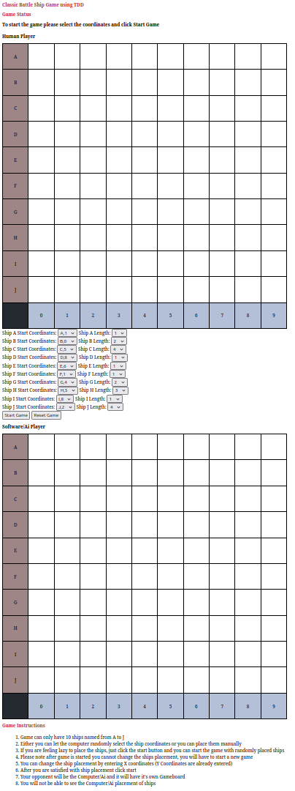
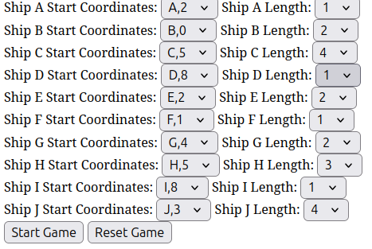
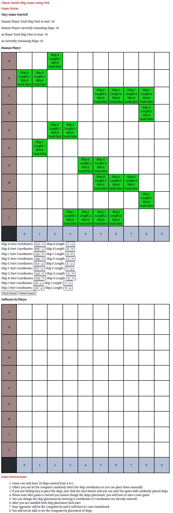
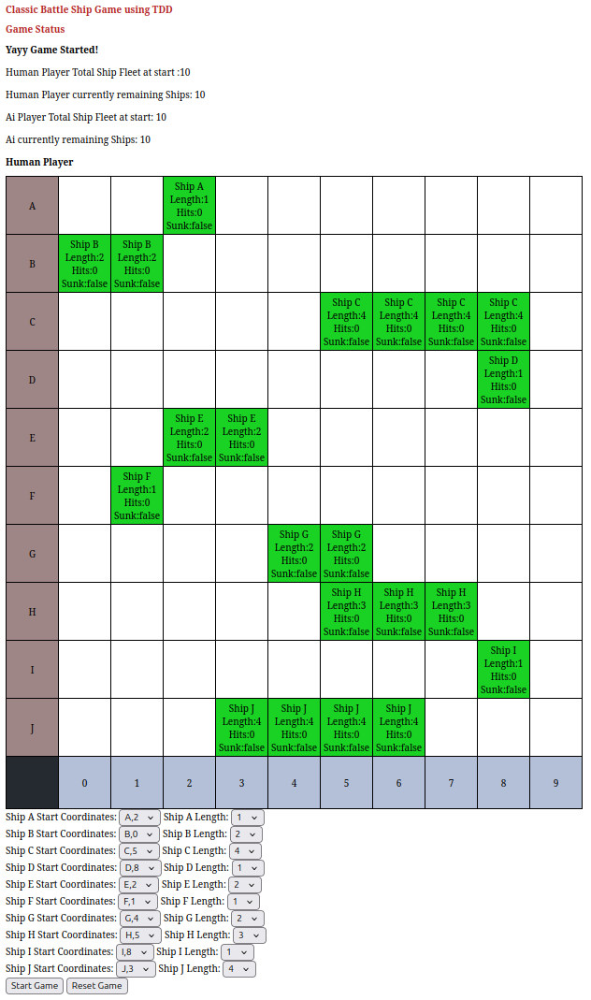
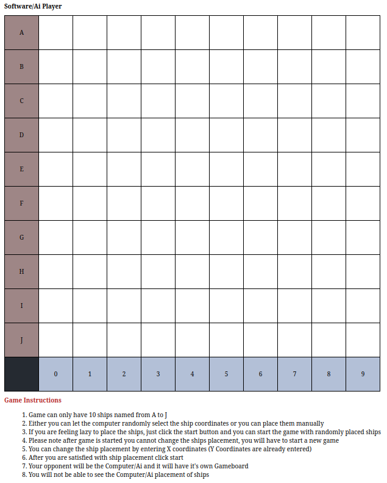
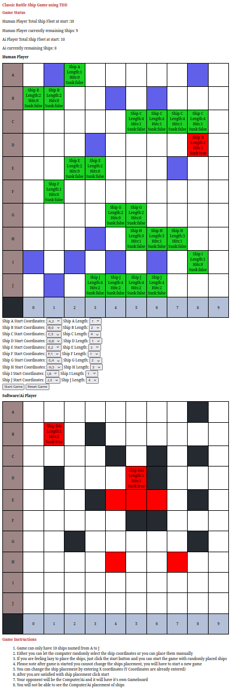
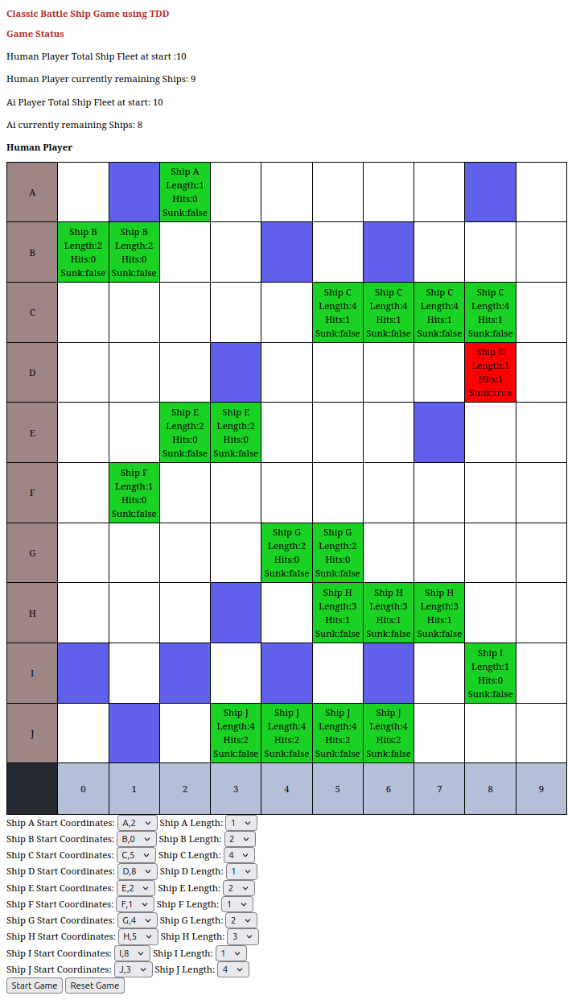
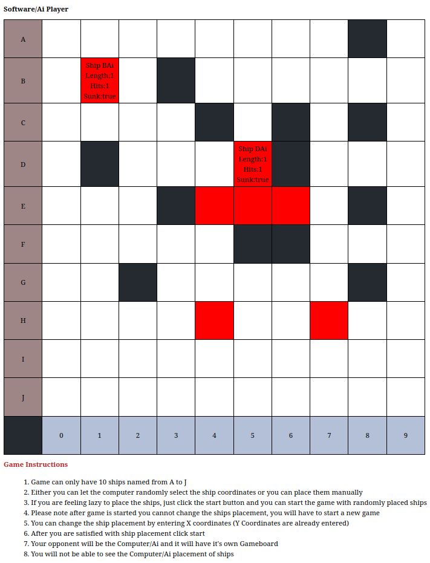
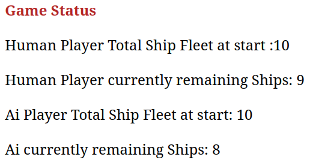

# Battleship Game

A browser-based implementation of the classic Battleship game, developed using Test-Driven Development (TDD) with JavaScript.

## Table of Contents

- [Overview](#overview)

- [Features](#features)

- [Screenshots](#screenshots)

- [Live Demo](#live-demo)

- [Tech Stack](#tech-stack)

- [Architecture](#architecture)

- [Getting Started](#getting-started)

  - [Prerequisites](#prerequisites)

  - [Installation](#installation)

- [Project Structure](#project-structure)

- [Available Commands](#available-commands)

- [Development Guidelines](#development-guidelines)

- [Testing](#testing)

- [Deployment](#deployment)

- [Troubleshooting](#troubleshooting)

- [Contributing](#contributing)

- [License](#license)

- [Acknowledgements](#acknowledgements)

- [Contact](#contact)

---

## Overview

Battleship is a browser-based implementation of the classic naval strategy game. The project was developed with an emphasis on Test-Driven Development (TDD), modular JavaScript architecture and separation of game logic from the user interface.

The application implements the core game mechanics through dedicated components responsible for ships, gameboards and players. The user interface interacts with these components to facilitate gameplay against a computer-controlled opponent.

The project demonstrates the application of JavaScript modular development, unit testing, Webpack bundling and automated deployment workflows.

## Features

- **Ship Management:** Represents ships, tracks hits and determines when ships are sunk.

- **Gameboard Management:** Handles ship placement, attack processing and tracking of gameboard state.

- **Player Management:** Supports human and computer-controlled players.

- **Computer Opponent:** Implements computer-controlled attacks using random coordinates while avoiding previously attacked positions.

- **Turn-Based Gameplay:** Players take turns attacking opposing gameboards.

- **Win Detection:** Determines when all ships belonging to a player have been sunk.

- **Test-Driven Development:** Uses Jest to test core game logic and component behaviour.

- **Modular Architecture:** Separates game logic from UI implementation.

- **Webpack Bundling:** Bundles JavaScript and CSS and generates the application HTML.

## Screenshots

### Game Setup

<p align="center">      </p>

### Gameplay

<p align="center">    </p>

### Game Result

<p align="center">  </p>

## Live Demo : [Battleship Game – Live Demo](https://amalk.au/tdd-battleship-game/)

## Tech Stack

| Category                 | Technology                                                   |
| ------------------------ | ------------------------------------------------------------ |
| Language                 | JavaScript (ES6+)                                            |
| Frontend                 | HTML5, CSS3 and JavaScript                                   |
| Bundler                  | Webpack 5                                                    |
| HTML Generation          | html-webpack-plugin                                          |
| CSS Processing           | css-loader and style-loader                                  |
| Testing                  | Jest 29                                                      |
| Test Environment         | jest-environment-jsdom                                       |
| JavaScript Transpilation | Babel 7                                                      |
| Test Integration         | babel-jest                                                   |
| Code Quality             | ESLint                                                       |
| Code Formatting          | Prettier                                                     |
| Package Manager          | npm (existing configuration); pnpm preferred for development |
| Deployment               | Git subtree and GitHub Pages workflow                        |

## Architecture

The application separates the core game logic from the user interface to support independent development and testing.

### Core Components

#### Ship

Responsible for representing individual ships.

- Tracks ship length.

- Tracks the number of hits received.

- Determines whether a ship has been sunk.

#### Gameboard

Responsible for managing a player's gameboard.

- Handles ship placement.

- Processes attacks.

- Tracks attack outcomes.

- Determines whether all ships have been sunk.

#### Player

Responsible for representing game participants.

- Supports human players.

- Supports computer-controlled players.

- Maintains a player-specific gameboard.

#### User Interface

The UI interacts with the game logic through JavaScript event listeners and renders the game state in the browser.

The interface provides the interaction layer for gameplay while the core game logic remains independent of the DOM.

### Game Flow

1.  Initialise the human player and computer opponent.

2.  Create and configure their respective gameboards.

3.  Place ships on both gameboards.

4.  Players take turns attacking the opposing gameboard.

5.  The computer selects attack coordinates without repeating previous attacks.

6.  Game state is updated after each attack.

7.  The game ends when all ships belonging to one player have been sunk.

## Getting Started

### Prerequisites

- [Node.js](https://nodejs.org/) installed.

- npm, included with Node.js.

- [pnpm](https://pnpm.io/) if using the preferred package manager.

### Installation

1.  Clone the repository:

    ```
    git clone https://github.com/amalk-au/tdd-battleship-game.git
    cd tdd-battleship-game
    ```

2.  Install dependencies.

    Using pnpm:

    ```
    pnpm install
    ```

    Alternatively, use npm to install dependencies from the existing lockfile:

    ```
    npm ci
    ```

3.  Run the test suite:

    ```
    pnpm test
    ```

    Alternatively:

    ```
    npm test
    ```

4.  Build the application:

    ```
    pnpm build
    ```

    Alternatively:

    ```
    npm run build
    ```

The production bundle is generated in the `dist/` directory.

## Project Structure

```
tdd-battleship-game/
├── dist/                    # Bundled application output
├── src/                     # Application source code
├── docs/
│   └── screenshots/          # Project screenshots
├── .gitignore
├── babel.config.js
├── jest.config.js
├── LICENSE
├── package.json
├── package-lock.json
├── README.md
└── webpack.config.js
```

The `src/` directory contains the application's JavaScript modules, HTML template, styles and supporting files.

The `dist/` directory contains the bundled application output generated by Webpack.

## Available Commands

The following commands are defined in `package.json`.

| Command         | Description                                                                       |
| --------------- | --------------------------------------------------------------------------------- |
| `pnpm test`     | Run the Jest test suite.                                                          |
| `pnpm build`    | Build the application using Webpack.                                              |
| `pnpm gh-pages` | Push the `dist` subtree to the `gh-pages` branch and push the current Git branch. |

Equivalent npm commands:

| Command            | Description                                           |
| ------------------ | ----------------------------------------------------- |
| `npm test`         | Run the Jest test suite.                              |
| `npm run build`    | Build the application using Webpack.                  |
| `npm run gh-pages` | Execute the configured Git subtree deployment script. |

### Development Watch Mode

Webpack can be run in watch mode to rebuild the application when source files change:

```
npx webpack --watch
```

This rebuilds the application as changes are detected.

## Development Guidelines

This project follows a Test-Driven Development approach.

1.  Write a test that defines the expected behaviour.

2.  Implement the minimum code required to satisfy the test.

3.  Run the test suite to verify the implementation.

4.  Refactor while keeping the tests passing.

5.  Repeat the process for additional functionality.

### Development Workflow

1.  Create a feature branch.

2.  Implement changes following the existing modular architecture.

3.  Write or update tests for the changes.

4.  Run the test suite.

5.  Build the application to verify bundling.

6.  Commit the changes.

Keep game logic independent of the user interface wherever practical to maintain testability and separation of concerns.

## Testing

Jest is used to test the core game components.

The test suite covers the public interfaces and behaviour of the application's game logic.

Areas of testing include:

- Ship creation, hit tracking and sinking behaviour.

- Gameboard ship placement and attack handling.

- Gameboard state and ship-sinking detection.

- Player interaction with gameboards.

- Computer player behaviour.

### Running Tests

Run the test suite:

```
pnpm test
```

Alternatively:

```
npm test
```

Jest is configured to use `jest-environment-jsdom` and a CSS module mapping to handle CSS imports during testing.

## Deployment

The application is deployed as a static web application.

**Live URL:** [https://amalk.au/tdd-battleship-game/](https://amalk.au/tdd-battleship-game/)

**Portfolio:** [https://amalk.au](https://amalk.au)

### Build

Generate the application bundle:

```
pnpm build
```

The generated files are placed in the `dist/` directory.

### GitHub Pages Deployment

The repository includes a deployment script that uses Git subtree to publish the `dist/` directory to the `gh-pages` branch.

The configured script is:

```
git subtree push --prefix dist origin gh-pages && git push
```

Run the configured deployment command:

```
pnpm gh-pages
```

Alternatively:

```
npm run gh-pages
```

The deployment workflow assumes that the `dist/` directory is available and that the repository's Git remote and branch configuration support the subtree deployment process.

The application is hosted under a subdirectory of the portfolio domain. Deployment configuration and generated asset paths must therefore remain compatible with the `/tdd-battleship-game/` path.

## Troubleshooting

| Issue                                            | Solution                                                                         |
| ------------------------------------------------ | -------------------------------------------------------------------------------- |
| Dependency installation fails                    | Verify that Node.js and npm or pnpm are installed correctly.                     |
| Tests fail                                       | Review the failing test output and verify the corresponding game logic.          |
| CSS imports fail during testing                  | Verify Jest's CSS module mapping and `src/styleMock.js`.                         |
| Webpack build fails                              | Check the source modules, dependencies and Webpack configuration.                |
| Deployment fails                                 | Verify the Git remote, `dist/` directory, subtree configuration and permissions. |
| Application assets fail to load after deployment | Verify the build configuration and asset paths for the deployed subdirectory.    |

## Contributing

Contributions, improvements and bug fixes are welcome.

1.  Fork the repository.

2.  Create a feature branch.

3.  Implement your changes.

4.  Add or update tests.

5.  Run the test suite and build.

6.  Commit your changes.

7.  Open a pull request.

For significant changes, consider opening an issue before submitting a pull request.

## License

This project is licensed under the GNU General Public License v3.0 (GPL-3.0).

See the [LICENSE](LICENSE) file for the full licence text.

## Acknowledgements

- [The Odin Project](https://www.theodinproject.com/) — for the web development curriculum and learning resources that inspired the development of this project.

## Contact

- **Author:** Amal K.

- **GitHub:** [@amalk-au](https://github.com/amalk-au)

- **Portfolio:** [amalk.au](https://amalk.au)

- **Issues:** [GitHub Issues](https://github.com/amalk-au/tdd-battleship-game/issues)

---

Developed by amalk-au
